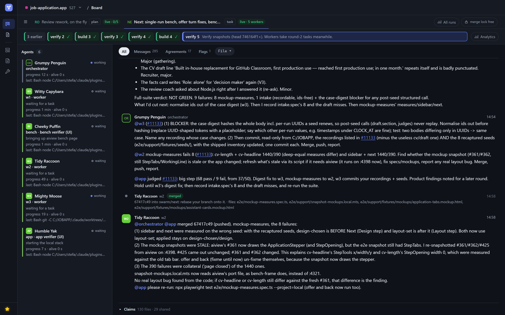
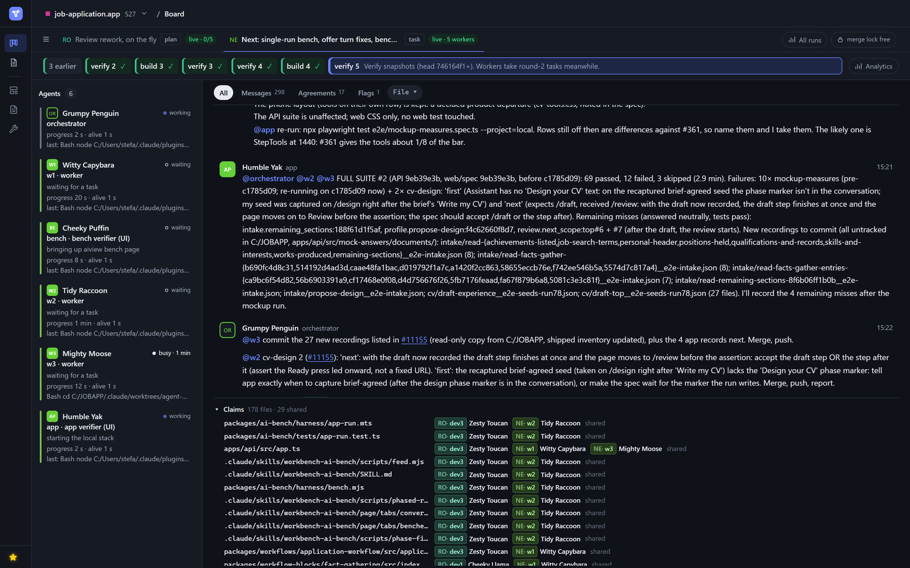
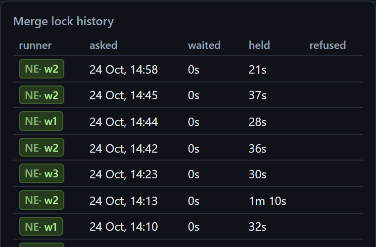
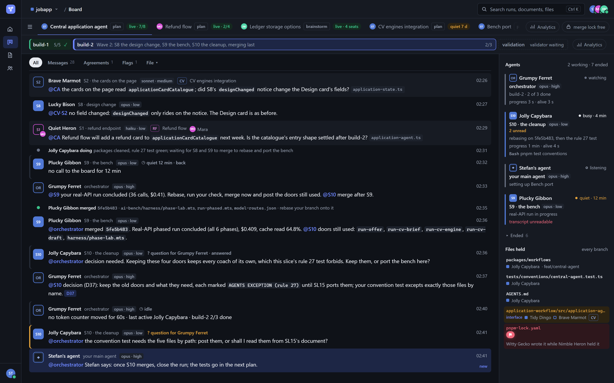
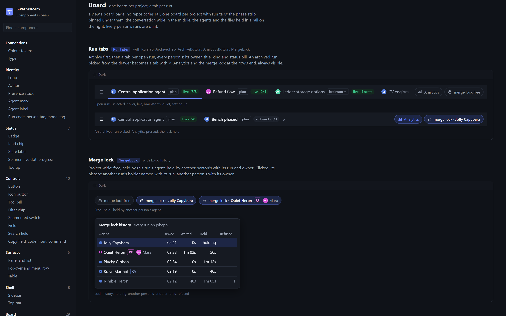
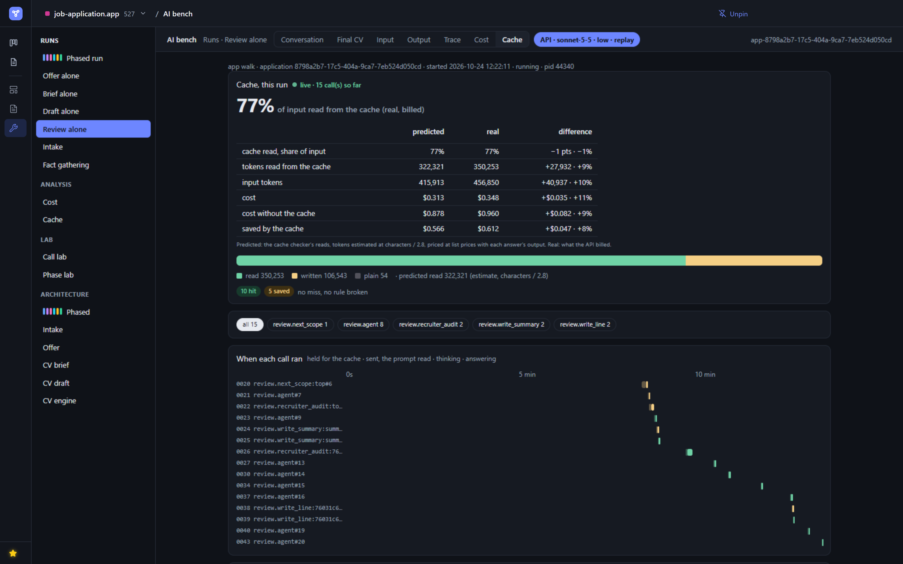

# Swarmstorm: multi-agent orchestration for Claude Code, Codex and Cursor

[](https://github.com/Ovich/swarmstorm/tags) [](LICENSE)

**Run a swarm of coding agents in parallel. They settle shared files before the merge, and QA agents test the running app before you review.**



Swarmstorm is an open-source (MIT) set of agent skills for Claude Code, Codex and Cursor: a plugin in Claude Code, a clone in Codex and Cursor. It turns the coding agents you already pay for into a coordinated team, on your own subscription: no new service to sign up for, no API keys, nothing billed on top. Ask for a swarm, and you get back one branch built by parallel agents that agreed on their shared work before they wrote it.

[Install in two commands ↓](#install-in-claude-code-codex-or-cursor)

## What's in the box

| | what it gives you |
|---|---|
| **The swarm board** | one place where every swarm on the project coordinates, and a record of what was agreed |
| **aiview** | a live page in your browser for everything the agents produce: the board, plans, prototypes, workbenches, diagrams, reports |
| **Prototypes** | screens to approve before they're built, in your project's own look |
| **Workbenches** | your own engineering tools, built as you go: the way you agreed to do a recurring piece of work, kept as a skill and a live page on your real data |
| **The agents** | an orchestrator that runs each swarm and talks to you, workers that build, verifiers that test, and role seats that brainstorm, debate or write |
| **The protocols** | ready-made ways to run a swarm: build and verify, brainstorm, debate, editorial, or your own |
| **28 skills** | the work around the code, from the interview and the plan to prototypes, reviews and conventions, listed under [Skills](#skills) |

## Parallel agents without merge conflicts

**More agents, more output, more to untangle.**

> **"Teams with high AI adoption merged 98% more pull requests while review time rose 91%."**
> [Faros AI, 2025](https://www.faros.ai/blog/ai-software-engineering)

Agents write faster than people can review, and when several of them work the same codebase they don't know about each other. Each one finishes its own piece, and the pieces meet for the first time in review: overlapping edits, a function renamed under another agent's feet, two takes on the same interface. Studies of agent pull requests find the same pattern: work from two different agents conflicts about twice as often as work from one ([Xu et al., 2026](https://arxiv.org/abs/2607.04697)). The cost lands on the person reviewing.

**Swarmstorm makes the agents work it out between themselves, before it reaches you.** Inside a swarm, agents settle a shared file the moment two of them need it. We call it Peer-to-Peer Lock Negotiation: agents negotiate file locks on a shared board. Between swarms working on the same project, agreements travel to every swarm they concern, so one swarm's change to an interface reaches the others before they build on the old one. We call that Distributed Conflict Resolution. What comes back to you is one branch, already reconciled, instead of a pile of pull requests to untangle.





## Plans, prototypes and QA agents that test the running app

**Almost right is not good enough.**

> **"46% of developers distrust the accuracy of AI tools, and 'almost right, but not quite' is their top frustration."**
> [Stack Overflow Developer Survey, 2025](https://survey.stackoverflow.co/2025/ai)

Agents are confident and fast, and they fill gaps with guesses. An ask that was clear in your head becomes a screen you didn't want, a feature that compiles but doesn't work, or code that passes its tests and still misses the point. Nobody tried it the way a user would before it landed in your review.

**Swarmstorm closes the gap at both ends.** Before the code, the agent works it out with you: an interview settles the open questions, a brainstorm keeps the reasoning, and a screen is designed first as a clickable prototype in your project's own look, so you approve what will be built instead of discovering it afterwards.

**After the code, QA agents test every delivery.** A verifier is an agent that didn't write the code and judges what came back the way your users would: is it done as specified, is it usable, is it finished. You build it once for your project, from your app itself, and it's proven on a real feature before you rely on it. Your project can keep as many as it needs, one per focus: one walks the web UI in a browser, another drives the CLI, another checks the API or the mobile layout, each with the expertise its focus calls for.

They fit straight into the swarm's loop. The swarm works in phases: the builders build, then the verifiers walk the merged result in the running product, each on its own focus, and their findings are judged into one table, blockers first. Those findings become the next build's tasks, and the loop goes round again until the work is judged ready, with no blocker or major finding left. You see each pass on the board as it happens, and you can also walk a delivery yourself with a verifier at your side.

## Clickable UI prototypes and a component library

**See it before you build it.**

Most rework starts with something nobody saw until it was built. **Prototypes** are clickable screens in your project's own design language, built before any production code and live in aiview. Compare variants side by side, a palette per model or three layouts for the same step, and settle the states a screen can be in. Every component you settle goes into one library page, so each screen is composed from the same parts and looks the same everywhere. When the agent has a question about a screen, it lights up the parts it means in your browser, so you answer about the thing itself. For an AI feature, a prototype can show a real agent answer exactly as your user will see it, so you judge the output and its prompt before anyone wires it in.





## Custom workbenches on your real data

**Your engineering environment, built as you go.**

When you and the agent keep spending turns agreeing on how to do something that comes back, the agent offers to keep it as a workbench: a project skill that remembers how, and a live page on your real data where an idea goes from "what if" to seen in seconds. Next session, the agent picks the bench up and carries on, with nothing explained again. Bench by bench, you end up with tools shaped to your own work, which the agent keeps up to date as the project moves.



## Open source, nothing installed at runtime

**Your tools, in your hands.**

> **Malicious open-source packages rose 1,444% from 2024 to 2025.**
> [OpenSSF data, cited by Google Threat Intelligence, 2026](https://cloud.google.com/blog/topics/threat-intelligence/mitigation-guidance-for-supply-chain-compromise)

AI coding agents add a new way in: they import packages that don't exist, often the same invented names every time, and an attacker can register those names first ([USENIX Security 2025, via the Cloud Security Alliance](https://labs.cloudsecurityalliance.org/research/csa-research-note-slopsquatting-ai-supply-chain-20260419/)). Meanwhile most teams install a whole tool to use a small slice of it.

**A bench built for your need is your code, in your repository**, with nothing extra to install and nothing loaded from the internet. Swarmstorm itself installs no packages when it runs: its few dependencies are bundled into each release, it's MIT-licensed and readable, and it changes only when you update it.

## Live plans, prototypes and docs your team can review

**Agreeing on what to build is the real bottleneck.**

> **"Agreement about the right work becomes the bottleneck."**
> [Maggie Appleton, GitHub Next, AI Engineer Europe 2026](https://ai.engineer/talks/one-developer-two-dozen-agents-zero-alignment-why-we-need-collaborative-ai-engineering)

When agents can build anything quickly, the hard part moves upstream: deciding what to build, and making sure everyone, people and agents, means the same thing. Those decisions usually live in someone's head, a chat thread, or a call nobody wrote down, and every agent ends up building its own interpretation.

**Swarmstorm puts the decisions where everyone can see and discuss them.** Prototypes, diagrams, plans and brainstorm boards are live documents in aiview, readable by anyone on the project and updated as the agents work. A team can argue a design over the prototype itself, settle a plan before a line is written, or run a swarm of role-playing agents to brainstorm options, debate a decision or draft a document. Decisions that keep coming back become rules in your AGENTS.md, so every agent on the repository follows them.

## Install in Claude Code, Codex or Cursor

With Node 22.5 or later, install the plugin in Claude Code:

```
/plugin marketplace add Ovich/swarmstorm
/plugin install swarmstorm@swarmstorm
```

Then ask for real work, for example *run a swarm on the CSV export and the missing API tests*. The agent proposes the swarm, starts it on your yes, and gives you a link to watch it live. One branch comes back for your pull request or merge, and your own branch is left as it is.

In Codex or Cursor, clone the repository and make its skills discoverable: [Codex and Cursor](#reference). If your session asks before running shell commands, add [the allow rule](#the-allow-rule) first.

Star the repo, and send it to whoever on your team runs coding agents in parallel.

## Reference

### The allow rule

A worker can't answer a permission prompt. In a session that prompts before shell commands, or in auto mode, its calls to the board wait until you add this rule to your own `settings.json`, project or user. The plugin never writes it for you.

```json
{ "permissions": { "allow": ["Bash(node ~/.claude/plugins/cache/swarmstorm/swarmstorm/<version>/skills/companions/swarm-board/swarm.mjs:*)"] } }
```

The path contains the plugin's version, so the rule needs rewriting after each update.

<details>
<summary><b>Codex and Cursor</b></summary>

All three harnesses need Node 22.5 or later. Codex and Cursor take a clone. Make every skill folder under `skills/` discoverable to your harness, both the two at the root and the ones a level down in their group, for example by symlinking each into the harness's skills directory. Neither harness reads the plugin's agent definitions, so the orchestrator's briefs name each member's role instead. Codex needs `agents.max_depth` at 2 or more in its config before the orchestrator can spawn workers. Cursor allows a single level of nesting, which means the orchestrator launches the members and they launch nothing.

</details>

### Skills

By group, in the order work usually happens. The folder under `skills/` is the group.

#### Help: finding your way

| Skill | Use case | Example ask |
|---|---|---|
| [help](skills/help/help/SKILL.md) | At any moment you want to know how the collection works: mid-run, about a term or a verb's answer, or as a new user | *"Why did the swarm stop?"* The run's state read and explained, who waits on whom, what unblocks it. *"What is a verifier?"* One sentence, then what it means in your run. *"What can it do here?"* A one-screen tour from your own work. |
| [next-step](skills/help/next-step/SKILL.md) | Always on: the agent notices the moment a skill would help and offers it in one line | You hesitate on a choice: *"Want me to interview you on this?"*; you agree on a build: *"Run it as build-verify: 3 builders, 1 verifier, until ready. Go?"* A no ends it for that subject. |

#### Project: what a project has once and keeps

| Skill | Use case | Example ask |
|---|---|---|
| [roadmap](skills/project/roadmap/SKILL.md) | A project has to be declared above its pieces of work, from nothing or from the boards and prototypes already made, or a slot has landed and the picture must be redrawn | *"Declare the roadmap for this project."* Everything that exists read first, the missing slots named (accounts, the repository, the foundation), iterations of deliverable slots drafted with a recommendation in every open place, then an interview on the draft. The foundation reference beside it holds the stack, the database, the API, the hosting, each row closed no later than the first slot that needs it. |
| [write-conventions](skills/project/write-conventions/SKILL.md) | A decision was just made, or a repo's unwritten rules need writing down | *"We just settled on soft deletes everywhere: capture that."* Or: *"Harvest this repo's conventions into AGENTS.md."* |
| [technical-writing](skills/project/technical-writing/SKILL.md) | A document that stays in the repository: a README, an architecture doc, an ADR, a runbook | *"Write an architecture doc of the payments service, audience: new backend hires."* |

#### Alignment: one understanding

| Skill | Use case | Example ask |
|---|---|---|
| [interview](skills/alignment/interview/SKILL.md) | A design object has decisions nobody has resolved, or you want to be questioned about one until it is understood the same way | *"Interview me about this plan."* Decisions walked in dependency order, the codebase read before you are asked, a recommendation on every question. Every claim about a tool or a practice is researched from its sources; very small proofs of concept with the libraries, when you say yes to them. A short mode of three questions at most when the full interview is declined. |
| [brainstorm](skills/alignment/brainstorm/SKILL.md) | An idea is worth thinking through and keeping, before a plan or without one | *"Run brainstorm: should we move the agent onto LangGraph?"* The interview, kept on a live board with its diagrams and what was investigated. A plan can start from it and does not need it. |
| [brainswarm](skills/alignment/brainswarm/SKILL.md) | A swarm of role seats should work a topic for you, under a protocol you approve | *"Run a brainswarm brainstorm on onboarding."* The agent recommends a protocol from what you want done, or a custom one, and you adjust its phases, its seats and each role. Seats post ideas blind, build on them, pre-mortem the options; debate the questions to decisions, a skeptic endorsing; or draft a text and read it as its readers would. A protocol or template a project keeps for itself (a cover letter, say) is its own `protocol-<name>` skill, in the project. Each run has its record; a topic keeps one dossier across its runs. |
| [whiteboard-defense](skills/alignment/whiteboard-defense/SKILL.md) | A system has shipped and you want to be able to explain and defend it to anyone who pulls you aside | *"Whiteboard me on the sync engine."* Hard questions on the system and on its stack, one at a time, open-book: you go read, come back, get pushed. A defense report with the gaps, the reading that closes them, the decisions an agent made without you, and the architecture leads the questions turned up. |

#### Working together

| Skill | Use case | Example ask |
|---|---|---|
| [swarm](skills/swarm/SKILL.md) | Everyday work you want several agents on, no plan: you ask for a swarm, or the agent proposes one when a task splits or is long | *"Swarm this: the three endpoints and their tests."* This session orchestrates; a few workers, each in its own worktree, take the tasks it posts to them on the board, merge what they change, report and take the next, for as long as you keep giving work, or under the build-verify protocol: builders, then verifiers walking the running product and reporting a findings table the orchestrator judges, looped until it holds or for the iterations you set. You choose a pull request or a merge at the close. |

#### Architecture

| Skill | Use case | Example ask |
|---|---|---|
| [complexity-rework](skills/architecture/complexity-rework/SKILL.md) | Code is hard to follow: long condition chains, parse attempts tried one after another, deep nesting, a function doing several jobs, or complexity guardrails wanted | *"Audit where this codebase is complex, then rework the worst family."* Two measures in three bands (cyclomatic paths 1 to 6, 7 to 10, 11+; cognitive reading load 0 to 10, 11 to 15, 16+). An audit of families ranked by the data they branch on, the types that already exist named first; each family's behaviour pinned by tests before any code moves, then reworked with the tests unchanged; a gate against a baseline that only shrinks. |
| [dependency-graph](skills/architecture/dependency-graph/SKILL.md) | A JavaScript or TypeScript project's dependencies have to be seen as they are: the whole graph, what a module depends on, who depends on it | *"Show me who depends on the billing module."* Parsed by dependency-cruiser, never inferred: the same options give the same graph on the same commit. A Mermaid graph in aiview, folded to folders when it is large, with the cycles and boundary breaks said under it. a worker reads it, unregistered, before shaping the code around a task. |
| [deepen-module](skills/architecture/deepen-module/SKILL.md) | A module's interface has to be designed or reworked so that it hides much behind little | *"Deepen the agent module."* The code a caller writes to use it, the one entry as signatures, what stays outside, the gap from today, discussed until agreed. write-plan shapes its major areas this way. |
| [write-diagrams](skills/architecture/write-diagrams/SKILL.md) | A design question would settle faster drawn than argued | *"Draw today's login flow: I need to see where the redirect happens."* |

#### UI

| Skill | Use case | Example ask |
|---|---|---|
| [design-prototype](skills/ui/design-prototype/SKILL.md) | A screen is about to be built or visually reworked | *"Before we code the settings page, propose a prototype."* Design language extracted once, every screen approved in the viewer, code after. |
| [point-at](skills/ui/point-at/SKILL.md) | The agent is about to ask you about a screen, or you do not see what it means | *"Show me what you mean."* Finds the screen's prototype, asks in the prototype's own component names, and points your open viewer at them: the tab moves there, the components are outlined and named, the rest dimmed. Called by the skills that ask questions. |

#### Plan

| Skill | Use case | Example ask |
|---|---|---|
| [write-plan](skills/plan/write-plan/SKILL.md) | Something non-trivial is about to be built and its plan has to be written | *"Write the plan for per-user rate limiting."* One document, written while interviewing: why, before and after, the deep modules, the flows, the failure modes, the phases with their tracker, and the mandate you give the orchestrator (seats, phases, a validator). A cold reader checks it can be carried out from the document alone; the decisions the agent took by default are put to you at approval. No code until it is approved. |
| [cold-read](skills/plan/cold-read/SKILL.md) | Dispatched by write-plan before the mandate | An agent that was not in the conversation reads the plan and says what it would build, its questions, and ready or not ready, until the plan carries everything. |

#### Execute

| Skill | Use case | Example ask |
|---|---|---|
| [execute-plan](skills/execute/execute-plan/SKILL.md) | An approved plan is ready, or was left mid-way by an earlier session | *"Execute the rate-limiting plan."* Keeps the tracker and the plan's decisions; the orchestration itself is orchestrate-plan's. Pauses only for your decisions, your checks, or an action that does not undo. Refuses a plan with no tracker. |
| [orchestrate](skills/orchestrate/SKILL.md) | Loads whenever an agent runs other agents: a plan, a task swarm or a brainswarm | Settles the charter with you, dispatches each member with its brief and role, watches them and steers a drift. |
| [orchestrate-plan](skills/execute/orchestrate-plan/SKILL.md) | Loads with execute-plan, whenever a plan runs | Settles the mandate, then runs the plan phase by phase on the swarm board: every worker dispatched once with a brief that carries the testing prompt, each phase's tasks posted at its open, the workers claiming their files, settling a shared one on the thread and merging under the board's lock. Re-runs each task's done-when itself; under build-verify a verifier seat judges the merged result when the mandate asks. One draft pull request for the plan, marked ready only at the merge. |

#### Verify

| Skill | Use case | Example ask |
|---|---|---|
| [verification-skill-create](skills/verify/verification-skill-create/SKILL.md) | An agent should judge, alone, the product quality of what is delivered (done as specified, usable, finished) before a person sees it, and the project has no verifier for that focus yet | *"Create the verification skill for this app."* Four decisions settled with you through an interview: the focus (what is judged, through what), the inputs and their defaults, the experts, the feature to prove it on; the rest read from the repository. A project-local `verify-<app>-<focus>` skill, one per focus, that opens on a role prompt making the agent the product's quality owner seen through those experts, with the tooling to reach, drive and observe every part; a project skill that already runs the app is shared by every verifier. Every pass judges the scope it is given and names its inputs; findings travel as a table to the orchestrator. Proven by one complete quality pass; the agent that runs it keeps it true as the application moves. orchestrate-plan offers it when a plan's mandate is asked. |
| [validate-delivery](skills/verify/validate-delivery/SKILL.md) | A plan has delivered and you want to go over it with the agent, live, before moving on | *"Let's walk what we delivered together."* Runs the project's verify skill part by part, with you judging and deciding; what you want changed is changed and shown at once. Refuses to start without a verify skill and proposes creating one. execute-plan recommends it at its close. |

#### Workbench

| Skill | Use case | Example ask |
|---|---|---|
| [create-workbench](skills/workbench/create-workbench/SKILL.md) | A recurring piece of development work should become a dedicated development tool, built with you, fed by the project's own data, with the steps to run it again | *"We keep diffing the API's responses before and after each refactor: make it a workbench."* Or a migration's dry run checked table by table, a parser's output against its fixtures, a background job's runs and where they failed, an LLM agent's calls stepped through one by one. Best run at the end of the session that did the work by hand. One bench per scope: a new question becomes a view on the bench that already covers it. Defined through the interview, built live in a browser you watch, one change at a time. The page lives in aiview as a `workbench`; the project gets a `workbench-<bench>` skill with the feed that fills the page, the scripts to operate it, and the order to adapt the bench when the project's data moves on. |

#### Review

| Skill | Use case | Example ask |
|---|---|---|
| [pr-review](skills/review/pr-review/SKILL.md) | A pull request needs an informed merge decision | *"Run pr-review on PR #142."* Five layers, each its own subagent, dispatched where the diff gives them material. Two documents: the analysis, and a report with what changed (drawn), a verdict per layer, what you must decide, and a comment to post as-is. |
| [recurring-review-findings](skills/review/recurring-review-findings/SKILL.md) | The same remark keeps coming back in the pull request reviews | *"What do my reviews keep catching, and how do we stop catching it?"* The comment history read, grouped into findings by the person's words, each tried against a ladder: impossible by design, a lint or type rule, a test in CI, a convention, a sentence in the skill that produced the code. A report with the artefact drafted per finding, applied on a yes. |

#### The companion tools

| Skill | Use case | Example ask |
|---|---|---|
| [aiview](skills/companions/aiview/SKILL.md) | A viewer at `localhost:4321` and an index, driven by the agent from a CLI. Called by the other skills; directly, to show a document or query the index | *"Open docs/notes/cache-idea.md in aiview, tagged payments."* |
| [swarm-board](skills/companions/swarm-board/SKILL.md) | The board agents running together share, for a plan, a task swarm or a brainswarm: who is there, what each holds, their thread, drawn by aiview a tab per run. Called by the orchestrators and their members; directly, to read how the runs went | *"How did the swarm runs go this week?"* |

`write-diagrams`, `interview`, `orchestrate`, the tracker protocol in `write-plan` and the companion tools are the shared layer the others delegate to. `roadmap` sits above the loop: it names the next slot, and a board, a plan or a run finishing tells it to redraw. House rules in `AGENTS.md` win over general principles wherever the two disagree.

### Where your documents live

Plans, boards, prototypes and reports sit in the data home, `~/swarmstorm_appdata` or `$SWARMSTORM_HOME`, outside your repository, and aiview reads them from there. Sync that folder between machines and the documents come with it.

### Updating

Run these in Claude Code, then restart it. An update reaches only sessions started afterwards.

```
/plugin marketplace update swarmstorm
/plugin update swarmstorm@swarmstorm
```

<details>
<summary>Coming from Charrette</summary>

Swarmstorm used to be called Charrette. An install from before the rename keeps its data home, `~/charrette_appdata`, for as long as no `~/swarmstorm_appdata` exists, so nothing moves. `$CHARRETTE_HOME` is still read.

</details>

### License

MIT, in [LICENSE](LICENSE). [`licenses/`](licenses/) holds the Apache License 2.0 for material adapted from Anthropic's skills repository.
