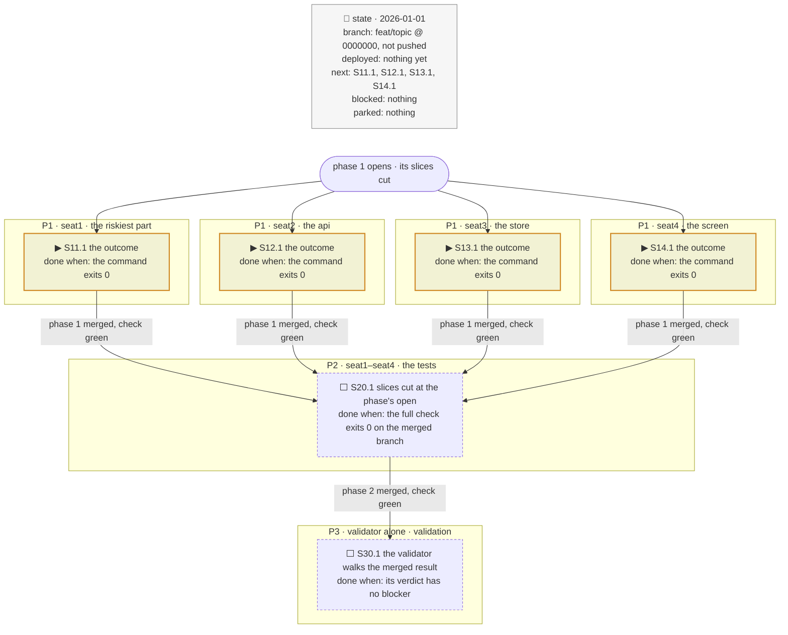

# A plan in swarm mode

Read when the mode is `swarm`. Everything else in this skill holds; this changes the cut, the
tracker and when the slice documents are written.

## The seats

- **The plan runs on N seats**, `seat1` … `seat<N>`, plus any special seat (a validator).
  N is the mandate's `seats:` field: propose it from the work, **4 for a normal plan**, 2–3 for a
  small one, 5–6 for a large one, and let the person change it.
- **A seat is a place in the swarm, not an agent.** Each phase dispatches a fresh subagent into
  it; what it learned reaches the next phase through the board's thread and its report.

## The phases

- **A phase exists only where work must wait for other work merged**: a contract, a move, a
  schema the rest builds on; the tests once the code stands; a validation once everything is
  in. Work that can run together is one phase. Most plans need one to three.
- **Every seat works in every phase**, one slice each, at most nine seats, a special seat's phase excepted: a phase has at most N slices. A
  phase with fewer slices than seats is a sign it should merge with its neighbour.
- **A special seat runs alone in its own phase**: the validator walking the merged result with
  the project's `verify-<app>` skill, which the mandate's `verify:` turns on, a
  reviewer reading every merge. No other seat works in it.
- **Each phase names every seat's role in it**: builder, tests, reviewer of another seat's
  merge, validator. A seat's role may change from one phase to the next.
- **The riskiest unknown goes in the first phase**, so the phases after it are cut knowing it.

## The slices

- **Only the first phase's slices are cut with the plan.** A later phase's slices are cut when
  it is about to open, from what the phases before it taught: its goal, seats and roles are
  fixed in the plan, its slices are not. The `write-slice` skill's `references/swarm.md` says how.
- **A slice is one seat's share of its phase**, cut thin and vertical as the `write-slice`
  skill's `references/cutting.md` says. Slices of one phase may share a file: their seats settle
  it on the board (the `swarm` skill); no fork proof, no blocker inside a phase.

## The tracker

**One subgraph per slice, titled with its phase and seat**, `P1 · seat2 · the api`, its id
`SL<phase><seat>` and its steps `S<phase><seat>.<step>`, the tracker's ids with the phase and
seat in the number (`SL12`, `S12.1`); a phase's slices are
arms from the phase before, joined at the next. Until a phase is cut, one subgraph `SL<phase>0` stands for it,
its one step saying its slices are cut at its open. With `tests: at the plan end`, the tests
phase's title ends `· the tests`.

- **One ▶ per running slice**: every seat of the open phase shows one.
- **A phase's placeholder `SL<phase>0` is replaced by its slices** when they are cut.
- **The board's row for a slice is its number**, `S12`.

## The mandate

**`mode: swarm` is the first field, `seats:` the second**, in the *Mandate* section and first
in the line under the tracker: `mandate: mode swarm · seats 4 + validator · run through · …`.
The *Mandate* section lists the phases, each with its goal and every seat's role. The other
fields are asked as for any plan.
