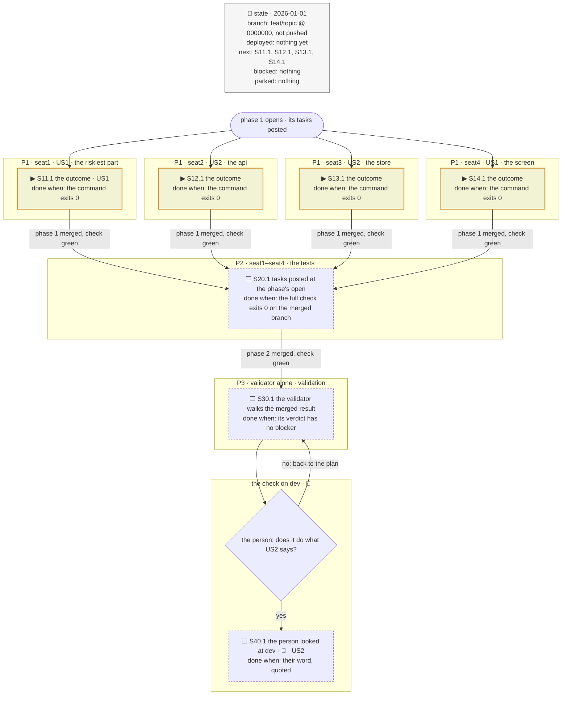

# The tracker's skeleton

Copy the block, replace every phrase, delete what the plan has no use for. Keep the caption
line above the fence and the mandate line under it. Unless `tests: at the plan end`, delete
the tests phase; unless `verify:` is on, the validation phase.

Phasing diagram: the phases, every seat's task in each, and what each phase has to show before the next opens.

mandate: seats 4 · phases 3 · verify at the end · run through · opus · medium · tests at the plan end
